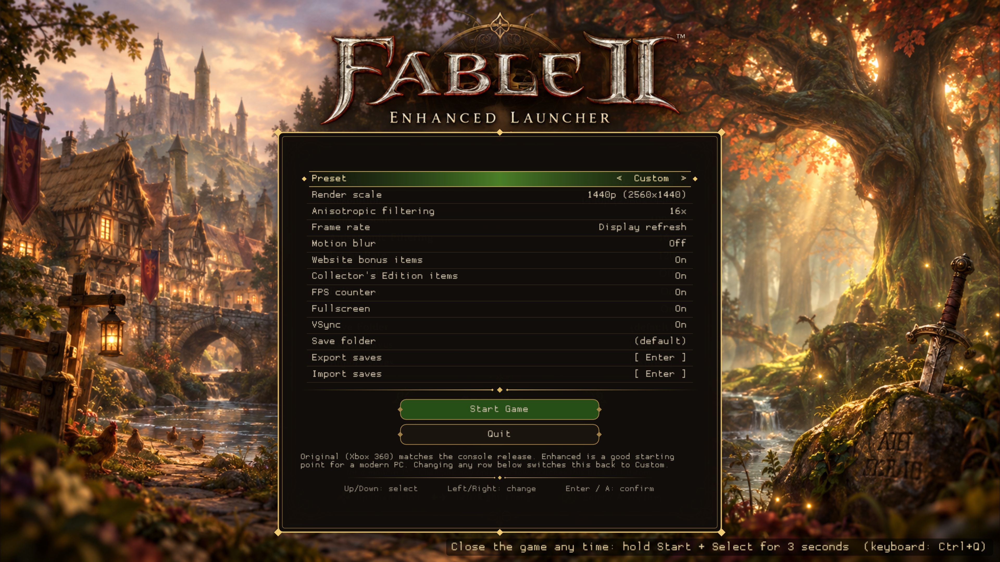
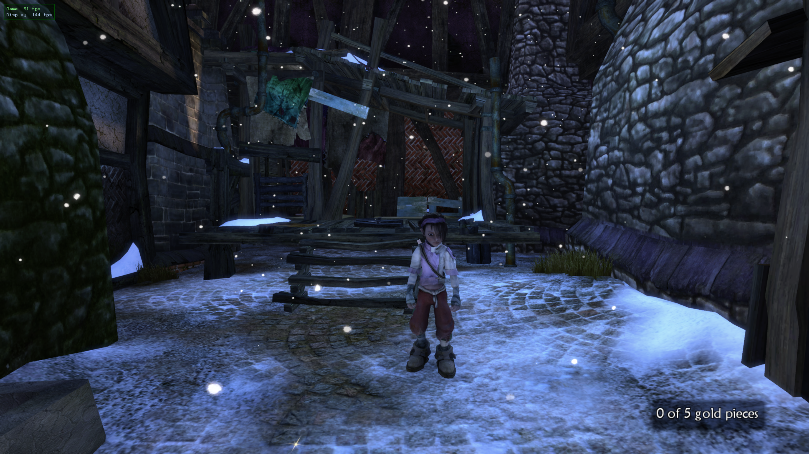
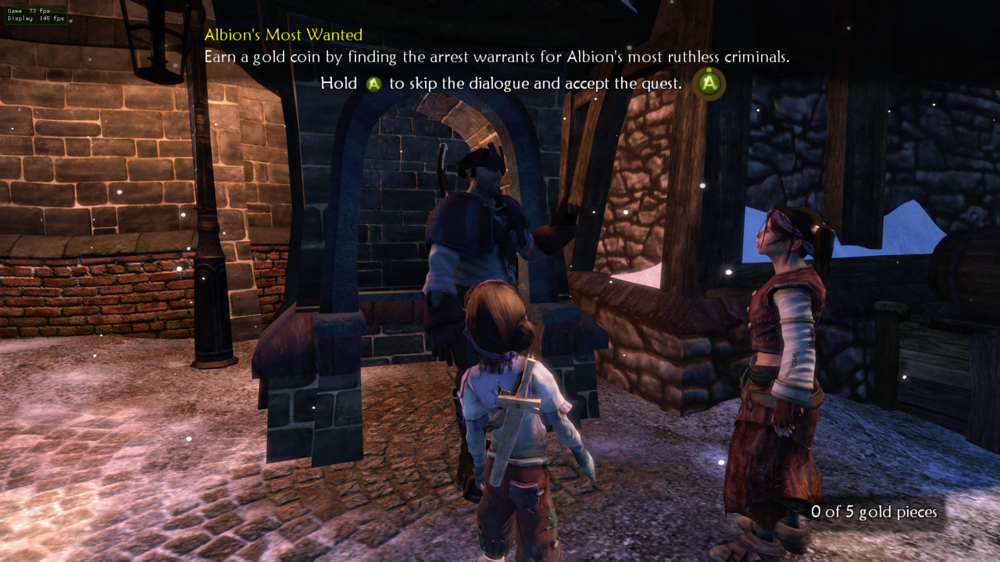
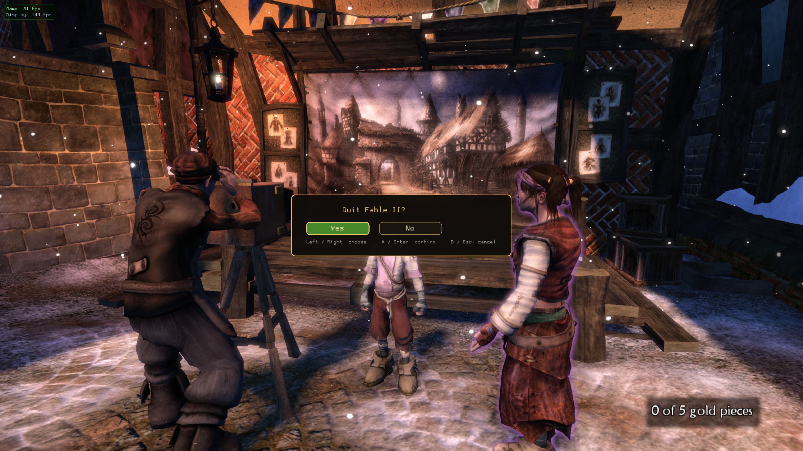

<!-- linux-top-begin -->
# Fable II: Linux Edition

**A native Linux build of the Fable II (Xbox 360) static recompilation, with a one-file installer and a controller-friendly launch menu.**

<p align="center"></p>

> **Bring your own game.** This repository contains no game files, no recompiled game code and no prebuilt game binaries. You build everything on your own machine from your own copy of Fable II.
> This project does not condone piracy. Mentions of or links to pirated copies will be removed and result in a ban from this repo.

**Fable II: Linux Edition** is a Linux-focused fork of [himdo/Fable-2-Recomp](https://github.com/himdo/Fable-2-Recomp), the original Windows recompilation built on the ReXGlue SDK. The recompilation itself is upstream's work. This fork adds everything needed to make it a one-download experience on Linux: an installer that builds the game from your own disc image, a launch menu you can drive with a gamepad, and the tooling around it. The Windows documentation is kept further down, and the Linux build still follows upstream.

## Get started on Linux

1. Download **`Fable2-Linux-Installer.tar.gz`** from the [latest release](../../releases/latest).
2. Extract it and double-click **Install Fable II** (or run `./fable2-setup.py`).
3. Pick your Fable II disc image (`.iso`) or an already-extracted game folder. Not sure where it is? Press **Find my game...**, choose a drive, and the installer searches it for you.
4. Wait while it checks the game, installs any missing build tools, builds and installs.
5. Launch **Fable II** from your application menu.

What the installer does for you:

- Reads the Xbox 360 disc image itself (no separate extractor) and checks `default.xex` against the supported version before building anything.
- Detects your distribution and installs the build tools it needs through your package manager (dnf, apt or pacman).
- Fetches the source, builds the game and installs it with a menu entry. Your game files stay on your machine.
- Has **Update** (pulls the newest port without touching your saves) and **Uninstall** (removes the port, keeps your saves unless you ask otherwise).

Requirements: a 64-bit Linux PC with a **Vulkan-capable GPU** (the game uses Vulkan for all rendering, so you need a working Vulkan driver, such as Mesa RADV/ANV or NVIDIA's), a working internet connection for the first run, and about 25 GB of free disk space while building (about 17 GB if you point it at an already-extracted folder). The build files are cleaned up afterwards.

**Supported game:** Fable II Game of the Year Edition. The installer accepts the `default.xex` with SHA-256 `88c4ef2e18e65409444d1b068eff921d1f7e180a5ae64edc64ba6b0872372662`. Other revisions are rejected.

**Tested on:** Ubuntu 24.04 and Arch Linux (both build and run, tested in containers). Nobara / Fedora 44 (KDE Plasma, Wayland) with an AMD Ryzen 9 7950X and Radeon RX 7900 XT, running at 4K with maximum settings. A PS4 controller (wired) is the pad used for testing. Reports from other distributions are very welcome.

### Packages the build needs

The installer installs these for you on Fedora-family, Debian-family and Arch-family distributions. On any other distribution, install the equivalents yourself first, then run the installer (it skips what is already there).

<details>
<summary>Fedora / Nobara / RHEL family (dnf)</summary>

`clang lld cmake ninja-build git gcc-c++ make python3 pkgconf-pkg-config vulkan-loader-devel mesa-vulkan-drivers wayland-devel wayland-protocols-devel libxkbcommon-devel libX11-devel libXext-devel libXrandr-devel libXcursor-devel libXfixes-devel libXi-devel libxcb-devel libXtst-devel libXScrnSaver-devel mesa-libEGL-devel alsa-lib-devel pulseaudio-libs-devel libdrm-devel mesa-libgbm-devel mesa-libGL-devel libdecor-devel dbus-devel systemd-devel libusb1-devel`

</details>

<details>
<summary>Debian / Ubuntu / Mint / Pop!_OS (apt)</summary>

`build-essential clang-20 lld-20 cmake ninja-build git python3 pkg-config libvulkan-dev mesa-vulkan-drivers libwayland-dev wayland-protocols libxkbcommon-dev libx11-dev libxext-dev libxrandr-dev libxcursor-dev libxfixes-dev libxi-dev libx11-xcb-dev libxcb1-dev libxtst-dev libegl1-mesa-dev libxss-dev libasound2-dev libpulse-dev libdrm-dev libgbm-dev libgl1-mesa-dev libdecor-0-dev libdbus-1-dev libudev-dev libusb-1.0-0-dev`

</details>

<details>
<summary>Arch / Manjaro / EndeavourOS / CachyOS (pacman)</summary>

`base-devel clang lld cmake ninja git python vulkan-headers vulkan-icd-loader mesa wayland wayland-protocols libxkbcommon libx11 libxext libxrandr libxcursor libxfixes libxi libxcb libxtst libxss alsa-lib libpulse libdrm libdecor dbus libusb`

</details>

The game needs **clang 19 or newer** (it uses C++23). Ubuntu 24.04's default clang 18 is too old, which is why the list above uses `clang-20`.

Immutable distributions (SteamOS, Bazzite, Silverblue and similar) are not supported by the installer yet. You would need to build inside a container with the packages above.

> A normal PC DVD drive usually cannot read the Xbox 360 game partition of the disc, so make an ISO of your disc first and give the installer that.

## What this fork adds

The Linux port, installer and launch menu were developed by [mootank93](https://github.com/mootank93) with AI assistance (Claude). Every item below has been built and tested on real hardware.

- [x] Native Linux build of the recompiled game
- [x] One-file installer: your ISO or folder in, installed game out
- [x] Built-in Xbox 360 ISO reader in the installer, checked byte-for-byte against `extract-xiso`
- [x] Window with the launch-menu artwork, native file pickers, and a terminal fallback
- [x] **Find my game:** pick a drive and the installer searches it for your disc image or game folder, with a manual fallback
- [x] Automatic build-tool installation for Fedora, Debian/Ubuntu and Arch families
- [x] Update and Uninstall, with saves kept safe
- [x] In-game launch menu with keyboard, mouse and gamepad support
- [x] Unlock toggles for the Website bonus items and the Collector's Edition items
- [x] Hold **Start + Select** for 3 seconds (keyboard: **Ctrl+Q**) to quit the game, with a "Quit Fable II?" confirmation
- [x] Controller-friendly folder and file browser for choosing the save folder and importing saves
- [x] Save import that backs up your current saves first
- [x] Releases with a changelog, screenshots and a single download

## What's next

- [ ] Test the installer on Debian/Ubuntu and Arch
- [ ] ARM64 build for handhelds (see below)
- [ ] Higher-resolution support
- [ ] Better performance and frame rate
- [ ] Windows compile check of the new menu code

## Screenshots

<p align="center">
  
  
</p>
<p align="center">
  
</p>

## The launch menu

When the game starts on Linux you get the launch menu first, where you choose your settings before the game boots. It is built to work with a gamepad, keyboard or mouse.

The menu has these settings:

| Setting | What it does |
|---|---|
| Preset | Quick starting points for the settings below |
| Render scale | Internal rendering resolution |
| Anisotropic filtering | Texture sharpness at an angle |
| Frame rate | Frame rate limit |
| Motion blur | On or off |
| Website bonus items | Unlock the Website bonus items |
| Collector's Edition items | Unlock the Collector's Edition items |
| FPS counter | Show the frame rate on screen |
| Full screen | Windowed or full screen |
| VSync | On or off |
| Save folder | Choose where your saves are kept |
| Export saves | Save a backup of your saves |
| Import saves | Restore saves from a backup (your current saves are backed up first) |

- **Move:** D-pad / left stick, arrow keys, or the mouse
- **Choose:** A (or Enter); **Back:** B (or Escape / Backspace)
- **Quit any time:** hold Start + Select for 3 seconds, or press Ctrl+Q. A box asks "Quit Fable II?" and defaults to No.
- **Folders and files:** Save folder and Import saves use a built-in browser you can drive with the pad, no keyboard needed

The artwork is AI-generated fan art, made for this project.

## Known issues

- **White window at launch (rare):** now and then the game freezes right at startup and the window stays white. Close it and start it again; the next launch normally works.
- **Controllers inside a container:** running the game inside a container such as distrobox can hide your controller from the game. Native installs are not affected in our testing.

## Where things go

| What | Where |
|---|---|
| Installed port | `~/.local/share/fable2-port` |
| Installer cache | `~/.cache/fable2-setup` |
| Saves (default) | `~/Fable2-Saves` (changeable in the launch menu) |
| Install record | `.fable2-port-install` inside the install folder (used by Update and Uninstall) |

Setting `FABLE2_PREFIX` before running the installer installs somewhere else.

## Building from source on Linux

Normally the installer does this for you. To build by hand, see [LINUX.md](LINUX.md) and run `linux/build.sh` with `FABLE2_GAME_DIR` pointing at your extracted game. The SDK used is [mootank93/rexglue-sdk](https://github.com/mootank93/rexglue-sdk), a fork of [himdo/rexglue-sdk](https://github.com/himdo/rexglue-sdk), included as a submodule.

## Handhelds (ARM64)

An experimental ARM64 build runs on a Retroid Pocket 6 (ArmadaOS, Adreno 740 with the Turnip driver). It starts, but performance is low (roughly 8 to 13 frames per second in the guest) and there are still graphical glitches, so there is no release for it yet. This work is paused for now.

## About the original project

The upstream project, by himdo, was started to test what local, open-source AI could do. Using Qwen it had the game running after about an hour; a long stretch of human trial and error then mapped enough functions to finish the game. It is not yet considered fully complete. The ISO that started it has SHA-256 `685a0d3bea9718812f17bcd155907a5359a548b6d3d8342dd2a6c944f45e35ff` (Fable II GOTY, USA and Europe). Upstream also reports working launches of the German, French, Italian, Russian and Spanish releases, though your mileage may vary.

## Credits and legal

- [himdo/Fable-2-Recomp](https://github.com/himdo/Fable-2-Recomp): the recompilation this port builds on
- [ReXGlue SDK](https://github.com/himdo/rexglue-sdk): static recompilation toolkit and runtime
- Launch-menu artwork: AI-generated fan art
- Fable II is a trademark of Microsoft and was developed by Lionhead Studios. This project is unofficial and not affiliated with or endorsed by them.
<!-- linux-top-end -->

---

# Windows build and developer notes

*Everything below comes from the upstream Windows project. It still applies to the Windows build and to anyone working on the code.*

# Current and planned features

Original GOTY USA/Europe and German GOTY dumps are supported by the default
`goty-compatible` build profile. Other XEX revisions remain rejected. See
[German GOTY validation and known limits](docs/GERMAN_GOTY_SUPPORT.md).
[x] Can be used to beat the game\
[x] Guild chest fully unlocked\
[x] Uncapped framerate / increased framerate\
[ ] Higher Resolution support\
[x] Built in Debug Menu
  - [x] Enabling custom lua to run in game

[x] Keyboard / Mouse Support\
[ ] In game Text changed to respect keyboard and mouse
  - [ ] Automatic swapping between text

[ ] Increased performance / framerate\
[x] Hero / Dog Texture bug fix (upstream renderer, verified on German GOTY)\
[ ] Vulkan support\
[x] Linux builds (experimental): see [LINUX.md](LINUX.md)\
[x] Custom commands to aid in debugging\
[ ] Improved Graphics rendering\
[ ] Custom menu(s) / modifying menus for extra functionality (like closing the game)\
[x] Supporting other languages
  - [x] Germany
  - [x] France
  - [x] Italy
  - [x] Russia
  - [x] Spain

[x] Custom Launcher
  - [x] Built in ISO extractor

## Windows launcher

The optional WPF launcher detects the original game edition and configures
output resolution, internal render scale, anisotropic filtering, FXAA, VSync,
window/fullscreen mode and a 30/60/120/144/165/240/unlimited FPS limit. It keeps its preferences
in `launcher-settings.toml` and writes `fable_2.toml`, preserving other settings
and a one-time backup. Preferences survive the runtime rewriting its config.
It can also extract the game straight from a disc image: the **Extract from
ISO** button opens a raw `.iso`, pulls out just `default.xex` first, checks its
SHA-256 against the supported-version list, and only once it matches does it
extract the rest of the disc (`default.xex` and `data/`) into the launcher's own
folder, with a live progress screen and a Stop button. It reads Xbox 360 GDFX
discs with the shared [X360Extract](tools/x360extract/) library, so its output
matches the `x360extract` tool byte for byte — making the launcher the simplest
way to get the game files in place, with no separate extractor tool.

The game-folder selection defaults to the launcher's own folder on first launch
and then remembers the user's saved location. Game files can live separately;
the launcher uses `--game_data_root`. Both applications are named Fable 2
Recompiled and use new project-owned icons.


# Notes for running the game
- **How to extract (built-in, recommended):** the launcher has an **Extract from ISO** button. Click **Extract from ISO** and pick your disc image (`.iso`). It first checks the iso against the supported-version list, and only once that matches does it extract disc (`default.xex` and `data/`) into the launcher's own folder. No separate tool is required.
- **How to extract (external GUI tool):** alternatively, rip the disc to an ISO and open it with **[XboxImageExtractor](https://github.com/dromex1/XboxImageExtractor)** — a GUI tool for Xbox 360 game images. It lists the image's filesystem; select `default.xex` and `data` and extract them into the project root (`data` extract as folders).
- **You must supply the game content yourself** (it is not in the repo): rip the Fable 2 GOTY (USA/EU) disc (the one with SHA-256 above) and put `default.xex` and `data/` in the project root. The build does not copy this into the build directories   
- **Saves live in `<build dir>\saves\`** — back that folder up to keep your progress, and copy it between build trees (Debug/Release) or machines to carry a save over.
- The `--game_data_root <path>` override still points the content root at a different tree (e.g. to run from a shared content copy without staging); saves/cache still land next to the exe.
- Although this was made for the US / Europe GOTY version I have been able to run the following regions: Germany, France, Italy, Russia, and Spain. Your milage may very if you use those regions.


## Running

To run the game you must:
1) Extract a downloaded copy release of the game 
2) Extract the "data" and "default.xex" from your copy of the game — easiest with the launcher's **Extract from ISO** button, or an external GUI tool (see "How to extract")
3) Run the fable.exe program and if no errors pop up then the game should launch and you are good to go
  - If an error pops up about the hash being wrong try to extract a different version of the game and then try again.


Optional command-line overrides (all normal `--cvar value` args):

| Argument | Effect |
|---|---|
| `--game_data_root <path>` | Use a different content directory (beats the exe-dir-only search) |
| `--update_data_root <path>` | Optional update content root |
| `--window_width` / `--window_height` / `--fullscreen` | Presentation options |
| `--keyboard_gamepad_map <map>` | Host keyboard -> guest gamepad button map (see below) |
| `--skipHash` | Skip the `default.xex` SHA-256 integrity check. The hash is still written to the log, but a mismatch no longer blocks launch (useful for a modified or non-catalogue XEX) |

## User config (fable2_config.toml)

The recomp has its own human-readable user config, `fable2_config.toml`, next
to the exe — separate from `fable_2.toml`, which is the ReXGlue SDK's cvar
config. It is staged by the build (once; user edits survive rebuilds) and the
game recreates it with defaults on launch if it is ever missing. Loaded in
`Fable2App::OnPostInitLogging()`; code in `src/core/fable2_config.{h,cpp}`.

- Missing keys -> built-in defaults; wrong types / unknown sections -> logged
  warnings, defaults used; a syntax error -> dialog + defaults (never blocks
  launch).
- To add a setting: add a member to `fable2::config::Values` (with default),
  read it in `Load()`, and document the key in `config/fable2_config.toml`
  **and** the embedded template in `src/core/fable2_config.cpp` (keep both in
  sync).
- Settings that back an SDK cvar (currently the `[input]` section:
  `keyboard_gamepad_map`, `mouse_look`, `mouse_look_scale`) are seeded into
  the cvar at startup — but only when no higher-priority
  source set it: `fable_2.toml` (cvar config), `REX_*` env vars, and the
  command line (e.g. `--keyboard_gamepad_map`) still win, and the F3 console
  can still change the value live.
- The `[patches]` section holds runtime toggles for the recomp-level
  (mid-asm hook) patches, consulted by the hook bodies on every call
  (`src/core/fable2_hooks.cpp`) — flip one and relaunch to A/B a patch with no
  rebuild. This includes `high_tick_rate` and `higher_hf_tick_rate` (Xenia
  "High Tick Rate" / "Higher HF Tick Rate"; turn both on together), which
  also drive the guest-image data writes below. There is no separate patch
  file.


## Keyboard controls

The game normally reads a gamepad via the Xbox 360 `XamInputGetState` API. A
synthetic "keyboard gamepad" input driver (`src/input/keyboard_gamepad.h`) is added
on top of the default SDL driver, so host keyboard keys can drive the guest on
top of (OR-merged with) whatever a real gamepad reports. The physical pad
keeps working; the keyboard just adds buttons. It is wired up in
`Fable2App::OnPreSetup` via `config.input_factory`.

The mapping is the `keyboard_gamepad_map` cvar, format `Key:Button,Key:Button,...`. Its default is no longer hardcoded in the binary: it comes from `[input] keyboard_gamepad_map` in `fable2_config.toml` (see User config above), which you can edit to remap permanently. The command line and the F3 console still override it per-launch / live.

- **Key** — a host key name understood by `rex::ui::ParseVirtualKey`
  (`E`, `Space`, `LeftShift`, `F1`, ...), or a mouse button: `LMB` (left),
  `RMB` (right), `MMB` (middle), and `XMB1`/`XMB2` (side buttons). Mouse
  button names are case-insensitive; a held mouse button behaves exactly like
  a held key.
- **Button** — a guest gamepad input: `A`, `B`, `X`, `Y`, `LB`/`RB` (shoulders),
  `LT`/`RT` (triggers), `Up`/`Down`/`Left`/`Right` (dpad), `Pause` (Start),
  `Select` (Back), `L3`/`R3` (thumb clicks), and `StickUp`/`StickDown`/
  `StickLeft`/`StickRight` (left thumbstick, full deflection while held).

The default layout (mouse buttons plus keyboard) is:

| Key(s) | Guest input |
|---|---|
| `LMB` | `X` |
| `RMB` | `Y` |
| `MMB` / `B` | `B` |
| `Shift` / `E` | `A` |
| `W` `A` `S` `D` | Left stick (up / left / down / right) |
| `Q` / `R` | Left / Right trigger |
| `Z` / `Tab` | Left / Right shoulder |
| Arrow keys | Dpad up / down / left / right |
| `Escape` | Pause (Start) |
| `M` | Select (Back) |


Remap at launch without recompiling, e.g.

```
fable_2.exe --keyboard_gamepad_map "E:A,B:B,Space:L3,Enter:Start"
```

### Mouse look (right stick)

Mouse movement is mapped to the guest **right stick** for camera control. The
movement since the previous poll is converted into stick deflection, so you
**sweep the mouse to look and stop to stop**. Two cvars control it:

| Argument | Effect |
|---|---|
| `--mouse_look <bool>` | Enable/disable mouse look (default `true`) |
| `--mouse_look_scale <n>` | Sensitivity: right-stick units per pixel of mouse movement (default `256`; larger = more sensitive) |

The defaults come from `[input] mouse_look` / `[input] mouse_look_scale` in
`fable2_config.toml` (edit there to change them permanently), the command
line overrides per launch, and both cvars are hot-reloadable from the in-game
console, so you can dial in the sensitivity live. Example: `fable_2.exe
--mouse_look_scale 512` for a more sensitive camera.

All cvars above are hot-reloadable, so they can also be changed from the in-game console.

## F5 — run an external Lua script

Pressing **F5** (host keyboard) runs an external Lua file in the in-game Lua
state, exactly the way the game's own `RunScript(path)` global does — but
triggered from the host. This lets you drop a plain `.lua` file on disk and run
it against the live game (no recompile of the scripts needed).

- **Default file:** `data/scripts/recomp/F5.lua` (the build stages
  `src/lua/*.lua` into `data/scripts/recomp/` next to the exe). The shipped
  `F5.lua` snapshots the hero's position (`QuestManager.HeroEntity:GetPosition()`)
  and shows `X / Y / Z` in a message box.
- **Path:** set by the `f5_lua_path` cvar (default `scripts/recomp/F5.lua`,
  resolved relative to the VFS root `data/`). Override per-launch with
  `fable_2.exe --f5_lua_path "scripts/other/MyScript.lua"`.
- **How it works:** `src/core/fable2_f5_lua.h` captures the
  `CScriptManager::RunScript` callable the first time the game loads a `.lua`
  script (via a probe on the LuaPlus bound-method dispatcher), then replays that
  call with your path when F5 is pressed. The file is loaded fresh on each press,
  so you can edit it live (the VFS re-reads it).
- **The script runs in the game's global Lua environment**, so it has the full
  game API (`QuestManager`, `Debug`, `GUI`, `Creature`, `Player`, ...). Plain
  text is fine — `RunScript`/`loadfile` compile it for you.

Implementation: F5 edge-detection in `src/input/keyboard_gamepad.h`, a per-frame
replay from the `MainRenderLoop` hook in `src/diagnostics/fps_meter.h`, and the
string-build + `RunScript` call in `src/core/fable2_f5_lua.h`.\
<br>
<br>
<br>
<br>

---


# Notes for dev who want to work on the build:

## Guest-image patches

Data patches for the loaded `default.xex` guest image (Xenia game-patches
ops), applied before the guest module launches: `Fable2App::OnPostLoadXexImage()`
→ `fable2::patches::ApplyAll()` (code in `src/core/fable2_patches.{h,cpp}`).
There is no patch file: each patch is switched on by a `[patches]` key in
`fable2_config.toml` (currently `high_tick_rate` and `higher_hf_tick_rate`).
**Scope: data patches only** — code-region ops are inert in this recomp
(guest `.text` is never executed); code patches are mid-asm hooks instead.
Full details: `docs/patches.md`.

## Guest function-call tracing (fable2_func_trace.log)

To figure out what each recompiled function does, every guest function entry
can be logged by name. Codegen emits `REX_FUNC_PROLOGUE()` at the top of
every function in `generated/default/fable_2_recomp.*.cpp`; the build hooks
that one macro (via `src/core/fable2_func_trace.h`, appended to the recompiled
PCH after the generated pch — no generated files are modified) so each entry
logs its name to `fable2_func_trace.log` next to the exe. Consecutive calls
of the same function are run-length encoded (per thread) to keep the file
small:

```
GetNewGameLoadingGlobal
sub_82189708 x 4821
LoadingScreen_Virtual43
sub_82CC1BC0 x 3
...
```

(`x N` means that function was called N times in a row; a bare name is a run
of one.)

**Session summary:** call counts are accumulated separately and written to
`fable2_func_summary.log` (same folder), one line per function, sorted by
total count:

```
18422331 x MainRenderLoop_82B9CD68
9711204 x __restgprlr_28
54 x Story_FirstChildCombat
```

It's refreshed every 5 s while tracing (and once more on clean exit), so you
can watch it in another window to see at a glance what's being called; the
last write is at most ~5 s stale even if the game exits via ExitProcess.
Counts respect the same on/off + filter as the text log.

Off by default (one atomic load per call when off). Enable with:

```
set FABLE2_FUNC_TRACE=1            rem every guest function entry
set FABLE2_FUNC_TRACE_FILTER=LoadingScreen   rem optional: only names containing this
```

Either output can be turned off independently (default: both on):
`FABLE2_FUNC_TRACE_LOG=0` skips `fable2_func_trace.log` (summary only),
`FABLE2_FUNC_TRACE_SUMMARY=0` skips `fable2_func_summary.log` (trace only).

or at runtime from a named-function override (see `src/diagnostics/fps_probe.h` for the
override pattern): `Fable2FuncTraceSetEnabled(true)` /
`Fable2FuncTraceSetFilter("LoadingScreen")` /
`Fable2FuncTraceSetSubsOnly(true)` /
`Fable2FuncTraceSetLogEnabled(false)` /
`Fable2FuncTraceSetSummaryEnabled(false)` / `Fable2FuncTraceFlush()`
(declared `extern "C"` in `src/core/fable2_func_trace.h`).

**Naming mode** (`FABLE2_FUNC_TRACE_SUBS_ONLY=1`): log only the unnamed
guest functions - names matching `sub_` + hex digits - dropping named
functions, the `__savegprlr_*`/`__restgprlr_*`/`__savevmx_*` register
helpers, and `xstart`. Both the text log and the summary honor it, so the
summary becomes a ranked list of the unnamed hot functions to name next.
Composes with the substring filter (`FABLE2_FUNC_TRACE_FILTER=82B9` narrows
to an address range).

**Launcher:** `fable2-functrace.cmd` (staged next to the exe) does the env
var dance for you and renames the previous session's log to
`fable2_func_trace_prev.log` first:

Arguments are keywords in any order (`subs` enables naming mode,
`trace`/`summary` pick which output file(s) are written, the backend word
picks the GPU path, anything else is the substring filter):

```
fable2-functrace.cmd                  D3D12, trace every call
fable2-functrace.cmd vulkan           Vulkan, trace every call
fable2-functrace.cmd subs             naming mode: only sub_<hex> functions
fable2-functrace.cmd subs LoadingScreen   naming mode + substring filter
fable2-functrace.cmd d3d12 82B9 subs  D3D12, address-range naming mode
fable2-functrace.cmd summary          summary file only, no trace log
fable2-functrace.cmd trace            trace log only, no summary file
```

With no `trace`/`summary` keyword both files are written (the default).
`summary` is the cheap option for long sessions - it avoids the multi-GB
sequential log while still accumulating the call counts.

It writes its own lightweight log (same pattern as `fps_probe.log`) rather
than the SDK spdlog logger, which would be far too slow at Fable 2's call
rate. To remove the feature: delete the `target_precompile_headers` block in
CMakeLists.txt + `src/core/fable2_func_trace.h` and rebuild.


## Remote control (automated input channel)

`fable_2.exe` runs a localhost TCP **remote control server** so an external
automation harness can drive the guest gamepad over JSON-lines messages —
no human at the keyboard. Design doc: `plans/ai-remote-input-control.md`.

**Debug builds only.** This is a debugging/automation channel — it opens a
localhost TCP port and injects guest input — so it must not ship to players.
It is gated on the `FABLE2_REMOTE_CONTROL` macro, defined only for the Debug
build; Release / RelWithDebInfo builds compile out the pad driver + server
entirely (no port is opened and `fable2_control.py` is not staged).

- **Where:** `127.0.0.1:8791` by default (configurable, see below). One JSON
  object per line; every request gets exactly one response line; keep-alive
  connections are supported.
- **How:** a second synthetic pad driver
  (`src/input/remote_gamepad_driver.h`) is registered next to the keyboard driver,
  fed by the server (`src/input/remote_control_server.h`). It OR-merges with the
  human pads and is **not** gated on window focus, so the AI can drive the
  game while it's in the background.

Quick start (from the build dir, game running):

```
python tools\fable2_control.py ping
python tools\fable2_control.py press A --hold 120
python tools\fable2_control.py get-state
python tools\fable2_control.py script --file repro.json
```

Or speak the protocol directly (any language):

```
> {"cmd":"press","input":"RT","hold_ms":900}
< {"ok":true,"input":"RT","release_in_ms":900}
> {"cmd":"script","steps":[
      {"delay_ms":500,"op":"press","input":"LB","hold_ms":2000},
      {"delay_ms":1000,"op":"press","input":"A","hold_ms":80}]}
< {"ok":true,"duration_ms":2500}
```

`hold_ms` ≤ 0 (or omitted) means *hold until released/cleared*; a positive value
auto-releases after that many ms. In a `script`, each step's `delay_ms` is a **gap
since the previous step** on a single clock — the example presses LB at t=500 (held to
t=2500) and A at t=1500 (held to t=1580), so `duration_ms` (when the last input stops
being active) is 2500.

Commands: `ping`, `info`, `auth`, `press` (`input`, `hold_ms`, `value`),
`release`, `stick` (`input` = `StkLx`/`StkLy`/`StkRx`/`StkRy`, `value`,
`hold_ms`), `state` (sticky baseline: `buttons[]`, `triggers{LT,RT}`,
`stk{lx,ly,rx,ry}`), `clear`, `script` (atomic timed sequence), `get_state`,
`game_state` (current boot/menu state, see below), `screenshot` (`path`; save
the current game frame as a PNG, see below), `cvar` (get/set any
cvar by name), `enable`/`disable`. Input names match the
keyboard-gamepad vocabulary (`A`/`B`/`X`/`Y`, `LB`/`RB`, `LT`/`RT`,
`Up`/`Down`/`Left`/`Right`, `Start`/`Back`, `L3`/`R3`, stick direction
shorthands). `StkLy` positive = forward (Fable 2 convention). `script` is a
single atomic message, so a repro sequence runs with no network round-trips
between steps.

### Game state

`game_state` reports which boot/menu screen the game is on so the AI can
navigate and verify its actions:

```
python tools\fable2_control.py game-state
> {"cmd":"game_state"}
< {"ok":true,"state":{"code":2,"name":"PressAScreen"}}
```

The classifier samples once per second on a background thread (independent of
the render loop, so it keeps working during the movie, which renders video with
no UI text) and reports one of:

| State | Meaning |
|---|---|
| `?` (Unknown) | Arena not mapped yet / undetermined (first ~1 s). |
| `PreMainMenu` | Splash / intro, before the "Press A" prompt. |
| `PressAScreen` | The "Press A to start" prompt is on screen. |
| `MainMenuMovie` | The idle movie is playing (no prompt / menu). |
| `MainMenu` | The main menu (reached by pressing A on the prompt). |

This follows the game's own state machine:
`PreMainMenu →(time)→ PressAScreen →(time)→ MainMenuMovie →(time)→
PressAScreen`, with `PressAScreen →(A)→ MainMenu` and
`MainMenuMovie →(A)→ PressAScreen`. The prompt vs. the menu are visually
indistinguishable (same element-list draw rate), so the transition into the
menu is driven by the A-press, observed on the final merged pad state (remote +
keyboard + physical — it works no matter which input drives A) and latched with
its exact timestamp. State changes are logged to the in-game logger
(`REXSYS_INFO`, same channel as the remote control) on transition only, and
every sample is written to `fable2_state_probe.log` when
`FABLE2_STATE_PROBE=1` is set.

### Screenshot

`screenshot` saves the **current game frame** as a PNG so the AI harness can
see what the game is showing:

```
python tools\fable2_control.py screenshot shots/after_jump.png
> {"cmd":"screenshot","path":"C:/shots/after_jump.png"}
< {"ok":true,"path":"C:/shots/after_jump.png","width":1280,"height":720,"bytes":2765798,"avg_luma":120}
```

`path` (required, UTF-8) is where the PNG is written; parent directories are
created automatically. The frame is read **in-process from the renderer's guest
output texture** — the exact frame the game just rendered, in GPU memory at the
guest's native resolution (1280x720 for Fable 2) — not from the desktop. So the
picture is the complete game frame even while other windows cover it or the game
is unfocused, and occluding windows never appear in it. Works with both the D3D12
and Vulkan GPU plugins (each implements `CaptureGuestOutput`). Each capture
blocks the connection for a few hundred milliseconds. Implementation:
`src/diagnostics/fable2_frame_capture.h`.

Config (`[remote]` in `fable2_config.toml`): `enabled` (default `true`),
`host` (`127.0.0.1`; `0.0.0.0` exposes it on all interfaces), `port`
(`8791`; if busy, `+1..+9` are tried, the bound port is logged at startup),
`token` (empty = no auth; when set, each connection's first line must be
`{"cmd":"auth","token":"..."}`). Every received command is logged (audit
trail) to `logs/`.

## Building

Everything the build needs is either in this repo or auto-fetched — **no
hardcoded paths**. Prerequisites (all standard tools):

- **CMake** ≥ 3.25 (on PATH)
- **LLVM** (clang/clang++/lld) — on PATH or the default `C:\Program Files\LLVM` install
- **Ninja** (on PATH, `%USERPROFILE%\bin`, or the WinGet package dir)
- **Internet** on first build — `build.cmd` auto-downloads the prebuilt
  ReXGlue SDK v0.10.0 (~100 MB) from the
  [official release](https://github.com/rexglue/rexglue-sdk/releases/tag/v0.10.0)
  into `out\tooling\rexglue-sdk-0.10.0\`. A compatible official SDK on PATH
  is used instead if present. Downloads never replace the source submodule.
- **Python and Git** for code generation and source-SDK preparation; **Visual
  Studio Build Tools / Windows SDK** (x64 developer shell) for the native build.

```
build.cmd               # configure + fable_2_codegen (runs rexglue codegen on the manifest)
build.cmd fable_2       # configure + build the full executable
build.cmd <target>      # any other CMake target
build.cmd -release [t]  # build as Release (-O3) instead of Debug (-r is short form)
```

The first `build.cmd` run fetches the official SDK if needed under `out/tooling`.
Both Debug and Release build the pinned, patched SDK from source; see
[runtime build requirements](docs/RUNTIME_FIXES.md). Game content is required
for code generation but is never published with this repository.

Manual/advanced setup (normally not needed):

```
tools\setup_sdk.cmd      # fetch the prebuilt SDK only (what build.cmd auto-runs)
tools\setup_sdk_src.cmd  # fetch the SDK SOURCE for the Vulkan plugin: clones
                         # rexglue/rexglue-sdk at the pinned commit
                         # (f5337cdc), pins its submodules to the SHAs in
                         # thirdparty/rexglue-sdk-submodule-pins.txt, and
                         # applies thirdparty/rexglue-sdk-local.patch. LONG
                         # (several GB).
git                     # only needed for setup_sdk_src.cmd
```

The build also accepts explicit overrides if you keep the SDK elsewhere:
`cmake -DREXGLUE_SDK_ROOT=<prebuilt SDK root> -DREXGLUE_SDK_SOURCE=<SDK source>`
(`build.cmd` sets `REXGLUE_SDK_ROOT`/`REXGLUE_SDK_SOURCE` from its own search).

- Toolchain: the `win-amd64-debug` preset (Ninja + clang) by default. The SDK's public headers use clang builtins (`__builtin_bswap32`, `__VA_OPT__`), so plain MSVC `cl` cannot compile the generated code — a `win-msvc-debug` preset exists but only works for targets that don't compile `generated/`.
- **Release builds:** `build.cmd` defaults to the `win-amd64-debug` preset (`-O0`, `out\build\win-amd64-debug`). Pass the `-release` flag (short form: `-r`) to select the `win-amd64-release` preset (`-O3`, `out\build\win-amd64-release`):

  ```
  build.cmd -release fable_2_codegen
  build.cmd -release fable_2
  ```

  Both configurations build the patched source SDK, with separate SDK build/staging trees. Release stages `rexruntime.dll` and `rexgpu-xenos.dll`; Debug stages `rexruntimed.dll` and `rexgpu-xenosd.dll`. **Debug builds are drastically slower at runtime** — the recompiled guest code, the runtime, and the Xenos GPU emulator all run at `-O0` with assertions enabled — so use Release for any performance-sensitive run. Omit the flag to build Debug again; the two build trees are independent and can coexist. After updating, rerun `build.cmd` to refresh the SDK selection in an existing CMake cache.
- Codegen runs as part of the build and re-runs automatically when `fable_2_manifest.toml` or `default.xex` change (tracked via the generated DEPFILE).
- A full clean build recompiles ~291 generated translation units (60,462 guest functions).

## Vulkan renderer

The goal is a Vulkan rendering path for the game (the SDK's Windows GPU plugin only ships a
D3D12 Xenos backend; the SDK's own Vulkan backend lives in `rexglue-sdk-src/src/graphics/vulkan/`
but is not compiled into the shipped plugin). Per the project constraint, all Vulkan work lives in
this repo. The SDK source itself is built as stock upstream **plus this
project's tracked local patch** (`thirdparty/rexglue-sdk-local.patch` —
see below); the upstream repo is never forked or pushed to.

**Stage 1 — foundation (DONE, verified).** A self-contained Vulkan pipeline that creates a window,
inits Vulkan, and presents a clear color, proving the whole stack on a real GPU:

```
build.cmd -release fable_2_vulkan_smoke
out\build\win-amd64-release\fable_2_vulkan_smoke.exe   # -> stable blue window
```

Pipeline: dynamic `vulkan-1.dll` loader (no import lib needed) → `VkInstance` → Win32 surface →
device (graphics+present queue) → swapchain (3 images) → render pass → per-image framebuffers +
command buffers (clear-color subpass) → semaphores/fences → present loop. Logs to
`vulkan_smoke.log` next to the exe.

Key implementation notes (hard-won):
- **Window via the SDK's UI framework, not raw Win32/SDL.** The window is created with
  `rex::ui::SDLWindowedAppContext` + `rex::ui::Window` from the *shared* `rexruntime.dll` — the
  same mechanism the game uses. Raw `CreateWindowExW` and the *static* SDL build both fail to
  create/init a window here; only the shared-SDL path (the `rex::ui::*` exports) works. The target
  links the `rexruntime.lib` import lib and stages `rexruntime.dll` next to the exe.
- `#define NOMINMAX` before `<windows.h>` is required (the SDK's `math.h` uses `std::min` /
  `std::numeric_limits::max`, which the Windows `min`/`max` macros would break).
- Image views backing the swapchain **must outlive the framebuffers** (destroying them early makes
  the driver fault in `vkCmdBeginRenderPass`).
- Vendored Khronos headers live in `thirdparty/vulkan` + `thirdparty/vk_video` (Vulkan 1.3.282).

**Stage 2 — render the game via Vulkan (in progress).** The SDK's Vulkan backend is a complete,
~1.4 MB renderer compiled into `rexgpu-xenos` only when `REXGLUE_USE_VULKAN=ON` (OFF by default on
Windows). Rather than re-implementing it, we build the SDK source **plus the
project's local patch** (`thirdparty/rexglue-sdk-local.patch`) into a Vulkan GPU
plugin and load it via the `gpu_plugin` mechanism, so the renderer can be **swapped at launch, no
rebuild of the game**:

```
tools\build_sdk_vulkan.cmd     # builds the SDK source with REXGLUE_USE_VULKAN=ON
                               # (auto-fetches it first via tools\setup_sdk_src.cmd:
                               # clone at the pinned commit + submodule pins +
                               # thirdparty\rexglue-sdk-local.patch, into
                               # thirdparty\rexglue-sdk-src) -> the plugin lands
                               # in <SDK source>\out\win-amd64\Release\rexgpu-xenos.dll
```

The SDK source is the stock `rexglue/rexglue-sdk` repo **plus this project's
local modifications** (`thirdparty/rexglue-sdk-local.patch`: the main-menu
crash fix in `exception_handler_win.cpp` + `xmemory.cpp`, and the Vulkan/
FPS instrumentation — see `docs/main_menu_crash_fix.md` and the patch
header). `tools/setup_sdk_src.cmd` reproduces that exact tree from the
tracked patch + submodule pins, so the source never has to live outside
this repo.

Two plugins are staged next to the exe, selected by the `gpu_plugin` argument:

```
out\build\win-amd64-release\fable_2.exe --gpu_plugin=xenos           # D3D12 (default; prebuilt plugin)
out\build\win-amd64-release\fable_2.exe --gpu_plugin=xenos-vulkan    # Vulkan (source-built plugin)
```

- `rexgpu-xenos.dll` is the prebuilt D3D12 plugin (staged by `GPU_PLUGINS xenos`).
- `rexgpu-xenos-vulkan.dll` is the source-built plugin (staged by CMake from the SDK build tree,
  Release-only). `Fable2App::OnPreSetup` loads it with `LoadGpuPlugin("xenos-vulkan", "vulkan")`,
  forcing the Vulkan backend (the plugin is compiled with both; the default `"any"` would pick D3D12).
- The source plugin must match the game's runtime: the Release source plugin imports `rexruntime.dll`,
  so it is staged for the Release game only (the Debug game links `rexruntimed.dll`).
- The SDK source location is resolved relative to this repo (`thirdparty/rexglue-sdk-src`,
  or a sibling `..\rexglue-sdk-src` for pre-existing setups) and can be overridden with
  `-DREXGLUE_SDK_SOURCE=<path>`.

## Manifest highlights (fable_2_manifest.toml)

Migrated from the XenonRecomp config (`XenonRecomp/fable2.toml`):

- 87 manual function boundaries. ReXGlue forbids the overlapping boundaries XenonRecomp allowed: three nested pairs were trimmed to end where the inner function begins, and `0x82C8D3F0` keeps its original full size with the nested `0x82C8D4E8` entry removed (the gap-fill otherwise extended the outer and emitted an illegal cross-function `goto`). Original sizes are recorded in the file's comments and in `XenonRecomp/fable2.toml`.
- 13 "gap seed" function entries (no size — the scanner sizes them) for branch targets the auto-discovery never registered: a chain of 8-byte thunks at `0x82C000F0`–`0x82C00128` plus stragglers (`0x82BEA25C`, `0x82CD7948`, `0x82C14D58`, `0x82F279D8`, `0x82E7E4F8`, ...).
- `setjmp_address = 0x83000200`, `longjmp_address = 0x82CA9260`, and two `[[invalid_instructions]]` data-table skips, carried over verbatim.
- The XenonRecomp register save/restore helper addresses (`restgprlr_14` etc.) have no ReXGlue equivalent and are preserved only as comments.
- Known runtime risk: codegen logs a handful of non-fatal "Unresolved conditional branch" warnings (e.g. `0x82C8D408`, `0x82C99E74`, `0x82C9A0BC`); those paths emit `REX_FATAL` if hit.

## Function naming rule (important)

A manifest `name` becomes a C symbol: codegen emits the function body as
`__imp__<name>` (extern "C"). A name must therefore NOT equal an XAPI export
of `rexruntimed.dll` (the DLL exports `__imp__<XAPI name>` for every
xboxkrnl/xam hook). If it does, the local definition silently shadows the
DLL import at link time (no linker error), and the generated import-thunk
registration (`fable_2_register.cpp`) routes XAPI calls into the guest
function body instead of the SDK kernel hook. That is what broke audio when
the game-internal KeWait re-implementations were named
`KeWaitForSingleObject` / `KeWaitForMultipleObjects`: the xboxkrnl import
thunks (0x832B28AC / 0x832B2CDC) started landing in the guest wrappers,
whose timeout field is milliseconds while kernel callers pass 100ns units
(0 = infinite). They are named `..._Guest` for this reason — keep it that
way. Check before committing name changes:

```
python tools/check_manifest_collisions.py
```
